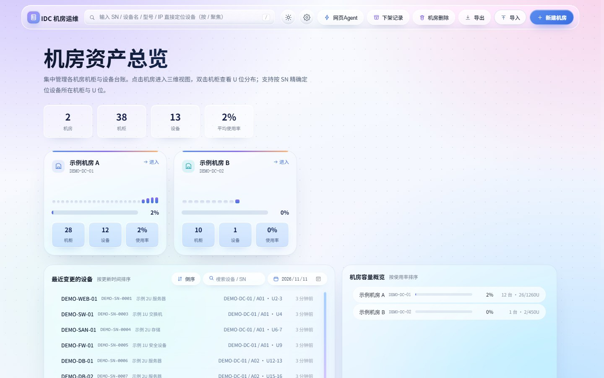
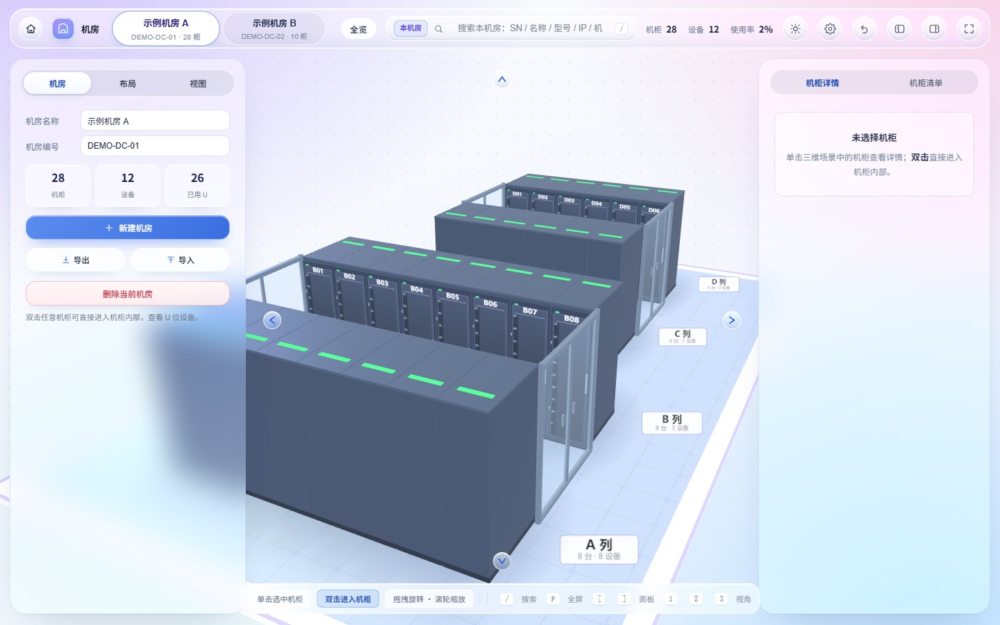
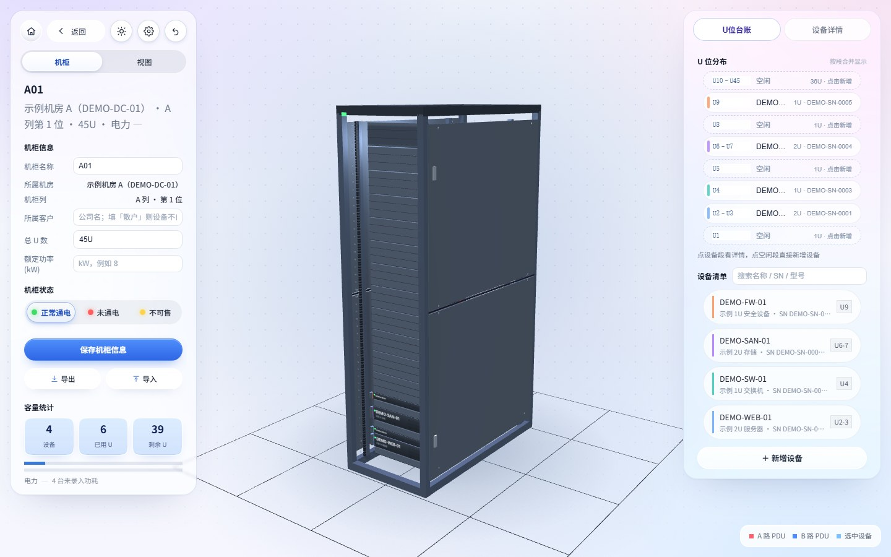
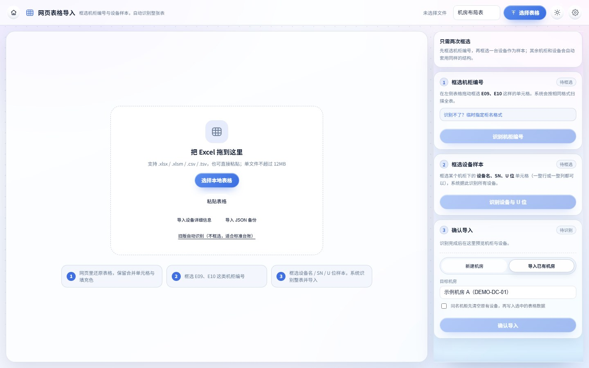

[简体中文](README.md) ｜ [English](README.en.md)

### 版权声明
本项目为非商用开源项目，版权归属项目主作者、Mr.Wang、Mr.Ding、Xudong、Mr.Liu、Jiaxiang 六位共同作者所有，仅用于技术学习交流，未经全体作者书面授权禁止任何商用行为。后续项目版权将整体转让至指定企业主体，受让企业可合法开展商用相关操作。

### 完整版权存证说明
本项目对外仅公开五类创新能力的**最小可运行证明子集**，用于证明原创功能与版权归属；全部完整实现（服务端主程序、完整导入识别引擎、零依赖 XLSX 读写引擎、完整自然语言 AI 规则引擎、前端 UI 与三维渲染、部署脚本与发行包等）由项目主作者、Mr.Wang、Mr.Ding、Xudong、Mr.Liu、Jiaxiang 六位共同作者共同独家持有，全量带不可篡改时间戳的提交记录已存证于作者本人名下的 GitHub 私有仓库 `RackAtlas-full` 中。
本项目（公开最小证明子集）首次公开提交的 Git 哈希值 `44c37598dc83653d7101900ab3631ad2733327d3`，与私有仓库 `RackAtlas-full` 中全量工程的首次提交哈希值 `c93e7ba378d2fd8dbc33f0f773d511ddb9d3bd1d` 形成唯一绑定，可在版权核验场景下交叉验证，作为完整版权归属的法定辅助举证依据。
全量代码的存证时间锚点为私有仓库 `RackAtlas-full` 的 GitHub 创建时间（created_at）`2026-11-10T11:47:43Z`（北京时间 19:47:43，由 GitHub 服务器客观记录、不可篡改）；公开仓库 `RackAtlas` 的 GitHub 创建时间（created_at）为 `2026-11-10T15:20:55Z`（北京时间 23:20:55），晚于私有仓库，符合「先有全量、后公开子集」。本公开仓库为最小证明子集，其证明子集代码逐字摘录自私有仓库的对应实现。两仓库根目录 `LICENSE` 协议文本逐字相同；私有仓库另含 `docs/版权存证核验.md` 记录同一组哈希。上述哈希指向的是**已经固定、不可改写的历史首次提交**，写入后续提交的 README 不会改变它们，因此不存在自指循环；本仓库后续提交一律为普通新提交，不 amend、不强制推送、不改写历史。

## RackAtlas · 机柜图谱

> **IDC 三维运维平台** —— 面向数据中心的机柜三维可视化与 U 位台账系统。

四层结构：**多机房 → 机柜列 → 机柜 → U 位设备**。门户选机房，三维大厅看机房布局，双击机柜进柜管理 U 位，输入 SN 一键定位设备，导出的 Excel 点一下就能跳回网页。

设计取向是**完全离线、零 npm 依赖、单 JSON 存储**：一个 `server.js` 起服务，一个 `data/rack.json` 存全部机房数据，Windows / Linux 双包开箱即用，适合内网与无外网环境的机房运维。

本仓库是它的**最小可运行证明子集**：只公开五类创新能力的核心逻辑与自检脚本，不公开任何完整实现。

## 公开范围（最小证明子集）

本仓库**刻意不公开任何完整实现**，仅公开五类创新能力的**最小可运行证明子集**，用于证明「这些功能确由本项目原创实现」以及版权归属：

| 创新能力 | 证明子集 | 可运行自检 |
|---|---|---|
| 设备 ↔ 网络设备接口联动 | `lib/linkage.js` | `node examples/linkage-demo.js` |
| 自然语言指令抗脏输入 | `lib/nl-public-demo.js` | `node examples/nl-demo.js` |
| 手动操作撤销与最近变更 | `lib/undo-public-demo.js` | `node examples/undo-demo.js` |
| Excel / JSON 导出设计 | `lib/export-public-demo.js` | `node examples/export-demo.js` |
| 导入时临时指定柜名识别格式（示例推断） | `lib/rack-format-public-demo.js` | `node examples/rack-format-demo.js` |

五个自检脚本均为纯内存、零依赖、不联网、不写盘，直接 `node` 运行即可验证，全部断言通过。

**本仓库不包含**：任何服务端主程序、HTTP 接口实现、UI 页面、样式文件、前端交互组件、三维渲染**代码与资源文件**、静态资源服务、完整导入识别引擎、零依赖 XLSX 读写引擎、完整 AI 规则引擎、系统管理或部署脚本。以上完整实现仅在私有仓库 `RackAtlas-full` 存证，以保证源代码安全。

`docs/screenshots/` 下的 5 张图片是**界面渲染截图**，仅用于 README 展示功能形态；它们不含任何源码，也不构成可据此还原界面的素材。仓库内不含任何 `.html` / `.css` / 前端 `.js` 文件。

## 五项创新能力

1. **设备 ↔ 网络设备接口联动**：设备详情只填上联交换机 SN 与端口号，即自动定位交换机、点亮对应端口；VLAN 变更同步回端口，端口冲突不静默覆盖，设备下架只熄灭自己占用的端口。证明子集见 `lib/linkage.js`，说明见 `docs/创新功能说明.md`。
2. **自然语言指令抗脏输入**：「一句话改数据」支持错别字、口语、混乱语句、中文分号多指令、问句不误判写操作、端口范围与电力词条等。只公开极小能力证明子集（约 220 行 / 完整实现 5190 行，逐字摘录不足 20 行），不含完整规则表、动作表、计划执行、大模型兜底、系统提示词与前端交互。说明见 `docs/AI创新功能说明.md`。
3. **手动操作撤销与最近变更**：每次手动修改前保存整库快照、后进先出撤销、步数上限；最近变更按时间倒序聚合、补齐机柜 / 机房、过滤孤儿记录。证明子集见 `lib/undo-public-demo.js`，说明见 `docs/撤销与导出功能说明.md`。
4. **Excel / JSON 导出设计**：导出选项白名单解析（格式 / 着色方式 / 超链接 / 机房范围 / 文件名 / 详情类型）、自定义颜色映射校验。证明子集见 `lib/export-public-demo.js`，说明见 `docs/撤销与导出功能说明.md`。
5. **导入时临时指定柜名识别格式（示例推断）**：内置规则覆盖不了某些柜名写法（如 `101机房A01`、`A区01`、`1F-A01`、`A栋01`）时，用户只需输入一个真实柜名示例，系统即按该示例的字符结构推断「房间号 / 列 / 序号」并解析整批柜名；只对本次导入生效，不符合示例结构的柜名不会被误读，失败自动回退内置规则。证明子集见 `lib/rack-format-public-demo.js`，说明见 `docs/创新功能说明.md`。

## 证明子集文件清单

- `lib/linkage.js`、`lib/nl-public-demo.js`、`lib/undo-public-demo.js`、`lib/export-public-demo.js`、`lib/rack-format-public-demo.js`：五个独立、自包含的证明模块（每个都是全量工程对应逻辑的**极小逐字摘录 + 演示级最小实现**）。
- `examples/linkage-demo.js`、`examples/nl-demo.js`、`examples/undo-demo.js`、`examples/export-demo.js`、`examples/rack-format-demo.js`：五个可运行自检。
- `docs/创新功能说明.md`、`docs/AI创新功能说明.md`、`docs/撤销与导出功能说明.md`：创新点与公开边界说明。
- `docs/screenshots/`：5 张界面截图（`01-portal-overview` / `02-room-3d` / `03-rack-u-positions` / `04-import` / `05-nl-command`），仅作展示，不含源码。
- `LICENSE`、`README.md`、`README.en.md`、`package.json`、`.gitattributes`、`.gitignore`：版权协议、双语文档与最小工程配置。

## 界面示例

以下截图来自**完整工程的实际运行界面**（`POST /api/reset` 载入的演示数据），仅用于展示功能形态：

**① 机房资产总览** —— 机房卡片、机柜 / 设备 / 使用率统计、最近变更、容量概览

**② 三维机房** —— 机柜列排布、顶盖电力条、按柜名 / SN 定位、视角漫游

**③ 机柜 U 位台账** —— U 位分布、设备清单、机柜信息与端口状态

**④ 表格导入** —— 拖拽 xlsx / csv、框选机柜编号与设备样本、临时指定柜名格式

**⑤ 一句话改数据** —— 自然语言解析为可确认的变更计划（规则引擎优先）

> 界面标题「IDC 机房运维」是产品自身的界面标题，项目对外名称为 **RackAtlas 机柜图谱**。截图中全部为虚构演示数据（`DEMO-*`、`192.0.2.x`），不含任何真实机房信息。

## 完整性校验

每次提交的日志正文记录本仓库全量文件的唯一 SHA-256 值。计算方式：排除 `.git/`，将全部文件按相对路径字典序排列，依次拼接「UTF-8 相对路径 + 0x00 + 文件原始字节 + 0x00」后取 SHA-256。据此可复算并核对本仓库内容是否被改动。

许可证全文见 [LICENSE](LICENSE)（中文为权威文本；英文 README 中的说明为便利性译文）。

## 联系方式

开源与版权事务（授权咨询、版权核验、漏洞私下报告、内容更正或下线请求）请联系：
**zyx.05@qq.com**

该邮箱为项目作者主动公开的联络方式，不属于任何机房运行数据。
